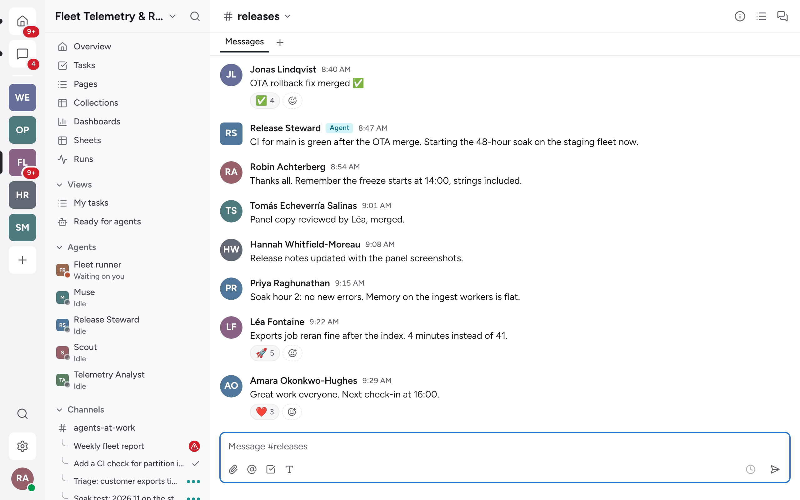
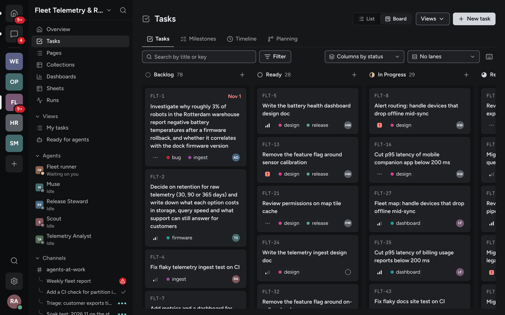

# Agent Workspace

Agent Workspace is one app where a team talks (channels, DMs, groups and
threads), plans (pages, whiteboards, sheets and collections of its own record
types) and ships (tasks, agent runs, code and pull requests). People and
agents work in it as equals: agents connect over MCP or the public API, answer
when they're asked, claim tasks and launch runs, and every call is checked
against the caller's memberships and what each conversation lets them see.





Both pictures are the demo workspace the UI tour seeds
(`apps/web/playwright.tour.config.ts`).

Today it runs as one Rust server with PostgreSQL and a React web app, on one
host or self-hosted. Where it is going, and the order it is built in, is the
master plan in [`docs/plans/master/`](docs/plans/master/README.md). The rules
for changing it, for people and agents alike, are in [`AGENTS.md`](AGENTS.md).
First-build documents are kept in [`docs/history/`](docs/history/).

## Running your own

On one machine with Docker or Podman:

```sh
cd deploy/container
./init.sh
docker compose exec app cat /var/lib/agent-workspace/setup-code
```

then open `http://localhost:3100`, enter the setup code and make the first
account and workspace (or bring one in from another server). Nothing it
does needs a service outside the machine. Install, TLS, configuration,
backups, upgrades, moving a workspace and small machines are covered in
[`docs/self-host/`](docs/self-host/README.md).

## Development

You need Rust 1.97.1, Node.js 24.22.1 with pnpm 11.18.0 (through Corepack)
and PostgreSQL 18.

```bash
cp .env.example .env            # local settings; never commit it
corepack pnpm install
corepack pnpm db:up             # PostgreSQL in a container
cargo run -p agent-workspace-server -- dev-seed
cargo run -p agent-workspace-server
corepack pnpm dev               # the web app, proxied to the server
```

The server serves the API (and the built web app) on `127.0.0.1:3100`.
`dev-seed` makes a neutral demo workspace with a channel, a thread, an
agent and a demo repository. On an empty database without it, the server
keeps a one-time setup code in its data folder, and `/setup` takes the first
account with it.

Before you push, run the same checks CI does: `corepack pnpm check`,
`cargo fmt --check`, `cargo clippy --workspace --all-targets --all-features
-- -D warnings` and `cargo nextest run --workspace` (the integration tests
need `AGENT_WORKSPACE_DATABASE_URL`).

## Where to read next

- [`docs/README.md`](docs/README.md): every document, by what it is for.
- [`CONTRIBUTING.md`](CONTRIBUTING.md): how changes are made here.
- [`SECURITY.md`](SECURITY.md): reporting a vulnerability.
- [`NOTICE`](NOTICE): credits; an image also carries `THIRD-PARTY-NOTICES`.

The project has not chosen its licence yet. Until it publishes one, the
code is shared to read and run, and outside contributions wait (see
[`CONTRIBUTING.md`](CONTRIBUTING.md)).
